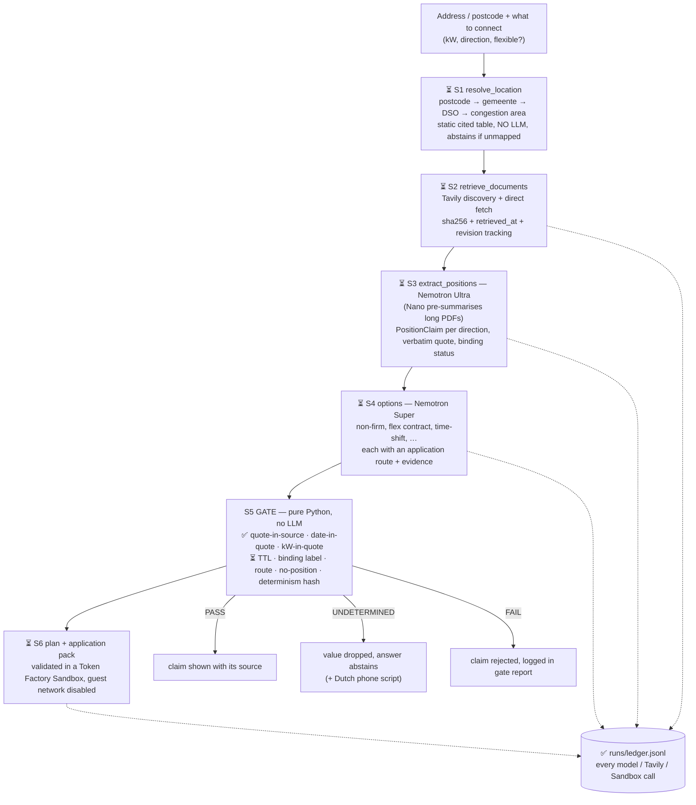

# Architecture & Dataflow — GridQueue

The authoritative design is [`SPEC.md` §3](SPEC.md). This page summarises it and marks what is built.
**Legend:** ✅ built · ⏳ planned.

Side lanes (all ⏳): **batch sweep** (`jobs/sweep.py` on a Nebius Serverless Job, ≥200 postcode areas incl. a
control sample) and **A/B** (Sandbox branching, gate-on vs gate-off over 60 queries, counting invented dates).

---

## Key subsystems

### 1. Contracts — `schemas/core-schemas.json` ✅
JSON Schema 2020-12 for every object that crosses a stage boundary. Many integrity rules are enforced at the
contract level, before the gate runs:
- a `PositionClaim` with an `indicative_earliest_date` must carry a `document_id`, a `verbatim_quote` and a
  non-null `publication_date` (GQ-DATE-01); dates must be ISO-like partial dates (`2028-Q3`, `2028-07`, …)
- an asserted `binding` / `non_binding` status needs the source's own words (GQ-BINDING-01)
- a kW figure needs a `capacity_basis_quote` (GQ-KW-01)
- a resolved location needs a DSO evidence citation
- a `model_estimate` option must set `model_estimate_flag` (GQ-ESTIMATE-01)
- `Citation.trust` cannot be `model_derived`

Tests: `backend/tests/test_schemas.py`.

### 2. Deterministic gate — `backend/app/gate/gate.py` ✅ (partial)
Pure Python, no network. A test parses the module's imports and rejects any HTTP or model client.
`DeterministicGate.evaluate()` returns `PASS` / `FAIL` / `UNDETERMINED` for one claim against one source
document; the semantics are in the [README](README.md#️-how-the-gate-works-built). The per-answer orchestration
from SPEC §6 (`build_answer`: TTL downgrade, binding labelling, option route checks, NO_OFFICIAL_POSITION_FOUND,
determinism hash) is not built yet.

Tests: `backend/tests/test_gate.py`.

### 3. Telemetry ledger — `backend/app/tf/ledger.py` ✅
Append-only JSONL, one line per external call, matching the `LedgerLine` contract. Writes take an exclusive
file lock so concurrent workers can't interleave lines. The location is `settings.runs_dir` (env `RUNS_DIR`,
default `<repo>/runs`). The Token Factory client wrapper that calls it (SPEC ticket C-T06) is not built yet.

Tests: `backend/tests/test_ledger.py`.

### 4. Sandbox verification — `backend/app/sandbox/` ⏳
Planned: build and validate the printable application pack inside a Token Factory Sandbox with guest networking
disabled, then record its sha256. This shows the pack only cites documents we actually hold. It is not a
guarantee against every form of leakage.
